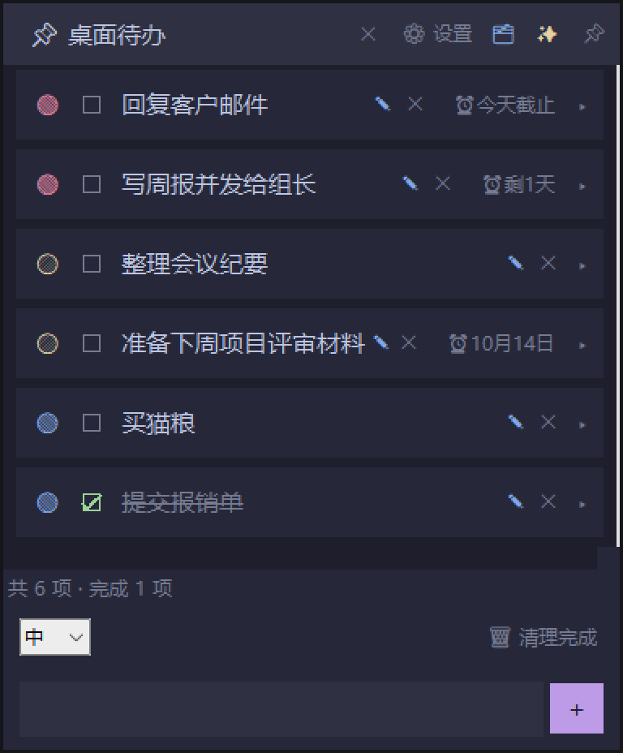

# 桌面待办 · Desktop Todo

一个常驻桌面的浮窗待办清单。置顶、半透明、无边框，随时看得见，随手就能勾。

Python + tkinter 写的，**零第三方依赖**，装好 Python 双击就跑。



## 功能

**基础**
- 置顶 / 半透明 (0.92) / 无边框 / 标题栏拖拽 / 右下角缩放
- 任务：添加、编辑、删除、勾选完成（右键菜单）
- 优先级 高 / 中 / 低（红 / 黄 / 蓝圆点）
- 开始日期 + 截止日期，自动生成到期提醒：`今天开始` / `X天后开始` / `今天截止` / `剩X天` / `逾期X天`
- 按优先级排序，已完成自动沉底；鼠标滚轮滚动
- 底部状态栏：`共 N 项 · 完成 M 项`

**✨ 一键整理**
- 把一段原始信息（会议纪要、聊天记录、邮件原文、随手记）粘贴进去，点「整理」
- **两种模式自动切换：**
  - **没配 API Key** → **本地规则整理**：按行拆分、识别日期词（今天 / 明天 / 下周三 / 10月8日）、按关键词判优先级、把长句精简成短标题。**不联网、零成本、装上就能用。**
  - **配了 API Key** → 交给 DeepSeek：区分「主责 / 协助 / 共同」，判断优先级、补全日期，更贴近原意。
- **结果先出一个候选审核页，勾选（还能改标题、改截止日期、改优先级）之后才写入待办**，不会直接动你的清单
- 已经存在同名未完成任务时，不会重复添加

**消息视角 —— 决定「你/我」指谁**

整理前除了填「任务归属人」，还要选这段文字是谁说的：

| 视角 | 含义 |
|---|---|
| **未知视角**（默认） | 不确定发言人是谁。有明确姓名 / @指派的照常提取；靠「你/我」才能判断的责任，放进待确认交给你定 |
| **本人发言** | 这段话是任务归属人本人说的，「我」＝他本人 |
| **对方发言** | 别人直接对他说（一对一），「你」＝他本人 |
| **多人对话** | 里面有好几个发言人，会逐条识别发言人之后再判断人称 |

> 为什么会误判：没有视角信息时，AI 只能猜「你/我」是谁，**同一句话换个说话人，结论会完全反过来**。所以宁可让它说「不知道」，也不让它猜错还写成「主责」。

**完成即归档**
- 勾选完成 → 自动追加一条到同目录的 `归档.md`
- 同一任务反复取消 / 重新勾选，**不会重复归档**（记录了归档标记）

**数据保护**
- `tasks.json` 用「临时文件 + 原子替换」写入，每次保存前自动留一份 `tasks.json.bak`
- 如果 `tasks.json` 已损坏，**程序会拒绝启动**，而不是拿空清单把旧数据覆盖掉
- `tasks.json` / `归档.md` / `config.json` 全部只在本机，**已在 `.gitignore` 里**，不会跟着仓库走

## 快速开始

1. 装 [Python 3.8+](https://www.python.org/downloads/)（Windows 安装时记得勾 **Add Python to PATH**）
2. 下载本仓库全部文件（`todo_desktop.py`、`todo_v2_core.py`、`todo_v2_review.py` 三个都要）
3. 双击 `启动桌面待办.bat`

也可以手动跑：

```bash
pythonw todo_desktop.py
```

任务数据存在同目录的 `tasks.json` 里，纯本地，不上传任何地方。

### 怎么填 API Key（可选，**不填也能用**）

**在软件里点标题栏的 ⚙ 就能填** —— 不用命令行、不用编辑器。

打开后把 Key 粘进去，点「保存」即可。Key 存在程序目录的 `config.json`，**只在本机、不上传、不进 Git**。

也可以手动配（适合批量部署）：

- 环境变量：`setx DEEPSEEK_API_KEY "sk-你的key"`
- 或 `~/.dsh/.credentials.yaml` 里写一行：`DEEPSEEK_API_KEY: sk-你的key`

Key 去哪儿申请：`platform.deepseek.com` → API keys

> **不填也行。** 点「✨ 整理」会自动用本地规则拆分条目、识别日期——只是它判断不了「这是谁的任务」，产出会全部落到「待确认」由你确认。

## 文件说明

| 文件 | 作用 |
|---|---|
| `todo_desktop.py` | 主程序：界面、任务管理、整理流程 |
| `todo_v2_core.py` | 数据安全读写、归档、提取规则与输出校验 |
| `todo_v2_review.py` | 候选任务审核窗口 |
| `test_todo_v2.py` | 离线单元测试，`python -m unittest test_todo_v2` |
| `启动桌面待办.bat` | 双击启动 |
| `CHANGELOG-v2.1.md` | 最近的改动说明与测试报告 |

## 更新记录

- **v2.1** — 新增「消息视角」，修人称代词误判；修审核窗滚轮不响应；离线标题不再整段照搬；离线不再丢日期。详见 [CHANGELOG-v2.1.md](CHANGELOG-v2.1.md)
- **v2** — 整理结果改为「先审核再写入」；区分主责 / 协助 / 共同；归档防重复；数据原子写入 + 损坏拒绝启动
- **v1** — 首个公开版本

## 为什么做这个

桌面待办工具用了一圈，要么太重、要么要联网、要么弹窗干扰。想要的是那种「**一直在那里，但不烦你**」的感觉——所以做成半透明置顶浮窗，不抢焦点，抬眼就能看到今天还剩什么。

## Roadmap

- [ ] 自动检测工作内容并收集（不用手动粘贴，自动把当天的工作沉淀成待办）
- [ ] 界面改版
- [ ] 打一个免装 Python 的 exe

## 反馈

有 bug 或者想要什么功能，直接开 [Issue](../../issues)。说清楚你的使用场景比说"不好用"有用得多，谢啦。

## 说明

代码版权归作者所有，欢迎试用和反馈。暂未指定开源协议。
